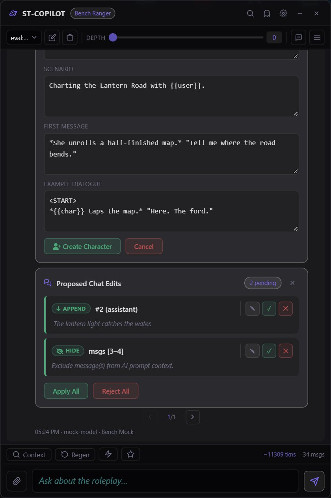
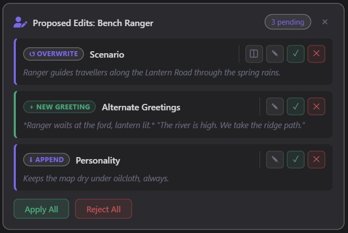
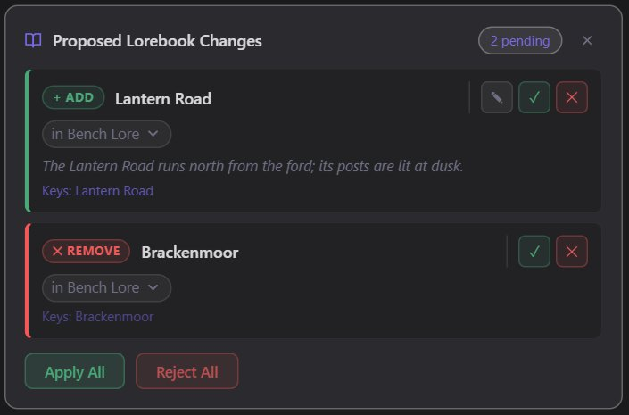
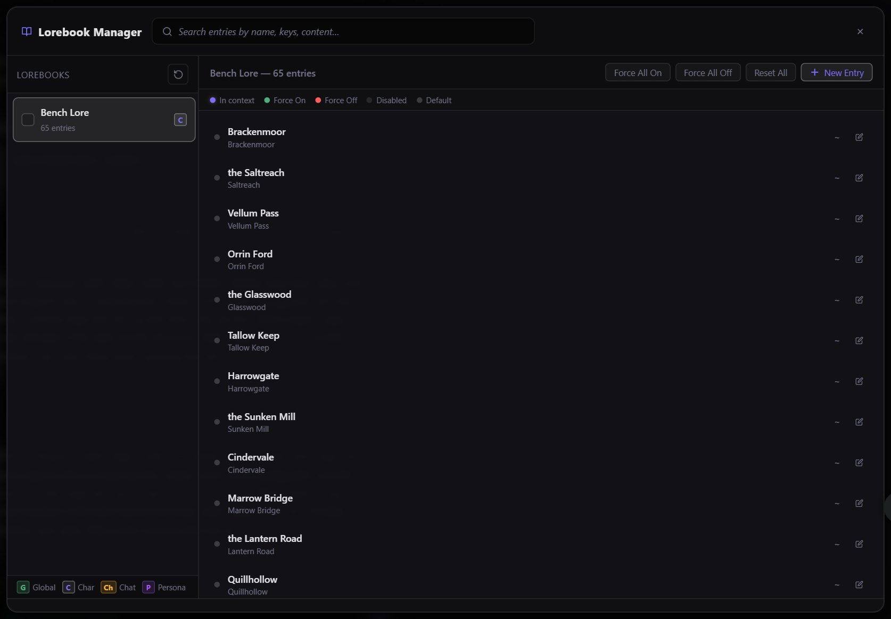

# ST-Copilot

An out-of-character assistant for SillyTavern. It lives in a floating window beside your roleplay, reads what you let it read (the chat, the character cards, the lorebooks, your persona, your roleplay prompts), and helps you think: plot ideas, scene analysis, continuity checks, lore you forgot. When you ask it to change something, it proposes the edit as a card you review, adjust and accept one change at a time. Nothing in your cards, lorebooks, chat or prompts changes until you accept it.

It never writes the roleplay for you. Its system prompt keeps it out of character, talking to you about the story rather than playing in it.

> **A maintained fork.** This continues [ST-Copilot](https://github.com/Supker/ST-Copilot) by QQ-Corporation / Supker from 2.9.0, with the fixes from the [Cheesedozer](https://github.com/Cheesedozer/ST-Copilot) and [keepsanity](https://github.com/keepsanity/ST-Copilot) forks. What changed in each version: [CHANGELOG.md](CHANGELOG.md) (versions before 3.0.0 are in the extension's What's New panel).

## Install

1. In SillyTavern, open **Extensions** (the puzzle icon) > **Install extension**, paste `https://github.com/Inversity/ST-Copilot` and install.
2. Reload SillyTavern.
3. Open Copilot from the **wand menu** (bottom left of the chat bar) > **ST-Copilot**, or press `Alt+Shift+C`.

If upstream ST-Copilot is installed, uninstall it first; your settings are kept.

**Compatibility:** 3.1.3 is tested against SillyTavern 1.19.0, `staging` branch at `ad29cbda6` (2026-10-03). It uses only extension APIs that are also in the `release` branch.

## First steps

- **Connection.** By default Copilot uses whatever API and model SillyTavern is using right now. To use a different one (a cheaper model for brainstorming, say), open Copilot's Settings (the gear in its window) > **AI** > **Connection** and pick a Connection Manager profile, optionally with another model from that provider, or a custom OpenAI-compatible endpoint.
- **What it sees.** The **Depth** slider in the toolbar sets how many of your latest chat messages go with each request. The pick button next to it lets you hand-pick messages instead. Settings > AI > **Context Payload** chooses the rest: your roleplay prompt, persona, which character card fields, hidden messages, alternate swipes.
- **Ask.** Type in the box at the bottom. The lightning button shows quick prompts (Analyze, Ideas, Summary, Feelings, Next?), which you can edit in Settings > Quick Prompts.

## The window

| Part | What it does |
| :--- | :--- |
| **Header** | The active character, search (`Ctrl+F`), Ghost Mode (transparent and click-through so you can read the chat underneath), Settings, minimize to a floating icon, hide. |
| **Toolbar** | Sessions for this chat (several separate conversations per chat, optionally temporary ones that delete themselves when you switch away; export and import), the Depth slider, the message picker, and the menu to the three managers. |
| **Messages** | Replies show their thinking (with how long it took, summed across tool rounds), any tools Copilot used, and the model that wrote them. Hover a message to copy, edit, regenerate, delete, star or continue it. Replies have swipes like SillyTavern's. |
| **Status bar** | While Copilot works: Thinking…, the tool round (`Tool round 2 (max 6)`), and after ten silent seconds "Model still working · no output for Ns", so a long think does not look like a freeze. Stop aborts. |
| **Actions bar** | **Context** shows exactly what is sent (the assembled messages, the JSON, and the request bodies SillyTavern actually sent). **Regen**, quick prompts, starred messages, and the estimated token count. |
| **Input** | `Enter` sends, `Shift+Enter` adds a line. The paperclip attaches text files or images (sent to the model directly, or described by SillyTavern's Image Captioning extension). |

## Edits you approve

Ask Copilot to change something and its reply ends with a proposal card. Each change shows what it would do; you can open a side-by-side diff, edit it before applying, then apply or reject it, or use Apply All / Reject All.

| Card | What Copilot can propose |
| :--- | :--- |
| **Character edits** | Rewrite, patch, prepend or append to any card field (description, personality, scenario, first message, example dialogue, tags, name, main prompt override, post-history instructions, author's note), and add or rewrite alternate greetings. Works per character in group chats. |
| **New character** | A complete new card, which you review and edit before it is created. |
| **Lorebook changes** | Add, edit, patch, append to or delete entries, including constant and outlet entries. |
| **Chat edits** | Edit, add, delete, hide or unhide SillyTavern chat messages, find-and-replace across a range, or rename the chat. |
| **Prompt edits** | Edit or toggle the prompts in SillyTavern's Prompt Manager (off by default: Settings > AI > Prompt Manager AI Edits). |

Edits are made with anchors: Copilot quotes the exact text it wants to change, and the change applies only where that text is found once. If the text is not there, or appears several times, the card says so and nothing changes; for a repeated phrase it offers **Change all N** after you check the diff. Accepted character edits go to SillyTavern's own copy of the character, so its editor and the Alternate Greetings popup show them at once.

## Tools

With tools on (Settings > Tools), Copilot looks things up before it answers instead of guessing, and each lookup shows as a card in the reply. A reply that uses a tool stops at the call, gets the result, and continues; the number of rounds per reply is capped (5 by default).

| Tool | Reads |
| :--- | :--- |
| Search Chat History, Read Messages, Get Recent Messages, Get Chat Statistics | The main chat: search, full messages, message numbers, counts |
| Get Lorebooks, Search Lorebook Entries, Get Lorebook Entry | Active lorebooks and their entries, in full |
| Get Character Info | Card fields as stored, with numbered alternate greetings |
| Get Roleplay Prompts | Your Prompt Manager prompts |
| Get Generation Settings, Get Regex Scripts, Get Quick Replies | Your SillyTavern setup, read-only |
| Ask User | Pauses to ask you a question (needs streaming) |

Every tool can be turned off on its own.

## Managers

Open them from the menu at the right of the toolbar.

- **Lorebook Manager.** Every active lorebook (global, character, chat, persona), which of them Copilot reads, and each entry's state: "active in ST" (in SillyTavern's roleplay prompt and Copilot's context) or "in context" (Copilot's only). Force an entry on or off for Copilot, or edit it directly. With Auto-Keywords on, Copilot sees the entries SillyTavern activated for the roleplay plus the ones your Copilot messages activate, under SillyTavern's own World Info rules.
- **Character Manager.** The fields of every character in the chat and your persona, with token counts, editable in place. Its **Overrides** tab chooses, per character, which fields Copilot sees.
- **Prompt Manager.** SillyTavern's roleplay prompts in send order: turn them on or off, edit them, and write the result into the preset file.

## Settings

Everything lives in Copilot's Settings window (the gear in its header). The entry in SillyTavern's Extensions panel is a short launcher: enable, the floating icon, and buttons to the window and to Settings.

| Tab | Holds |
| :--- | :--- |
| **AI** | Configuration profiles (save, switch, auto-load for a character or chat), connection, context payload, the system prompt and the edit prompts (each with presets). |
| **Interface** | Window behaviour, shortcuts, completion sound, Ghost Mode, background image or video, theme editor (12 presets plus your own, every color editable, import and export). |
| **Quick Prompts** | The quick prompt buttons and saved sets of them. |
| **Session** | Overrides for the current Copilot session only (connection, context, prompts, edits, memory, tools), each with a reset; and at the bottom, clearing this chat's sessions, cleaning up orphaned session files, and the debug log. |
| **Memory** | Facts about you as a Copilot user (preferences, standing instructions) that Copilot keeps across sessions. It adds them itself; you can add, edit, disable or delete them. |
| **Tools** | The tools switch, rounds per reply, the tools prompt, and each tool. |
| **Stats** | Messages, tokens, edits and more over time, globally or per character or chat. |

Which character fields Copilot sees is decided in three layers: a character's own override (Character Manager > Overrides) beats this session's override, which beats the global setting. Wherever a stronger layer decides, Settings shows a tag such as "set by this session: off" or "set by Bench Ranger: off".

## Keyboard shortcuts

| Keys | Does | Note |
| :--- | :--- | :--- |
| `Alt+Shift+C` | Show or hide the window | Anywhere, except while you are typing in another text box |
| `Ctrl+F` | Search the Copilot session | Only while the Copilot window is active (you last clicked in it); elsewhere the browser's own find works |
| `Alt+Shift+G` | Ghost Mode | Anywhere |

Each can be rebound or turned off in Settings > Interface > Shortcuts.

## What is sent where

Copilot sends requests only to the connection you chose, through SillyTavern the same way its own requests go, and only what the Context view shows. Its sessions are saved as files in your SillyTavern user data (`user/files/copilot_sess_*.json`, one per chat); Settings > Session > Clean Up Orphan Files removes the ones no chat uses any more.

## Languages

The interface follows SillyTavern's language. A Korean translation is included; the parts added in 3.1.2 were translated by Claude, not a native speaker, so corrections are welcome.

## Development

Edit `src/`, then `npm run build` (Rollup bundles `index.js`, which is what SillyTavern loads and must be committed) and `npm test`. Before a release, check SillyTavern's extension-facing files (`public/scripts/st-context.js`, `extensions/shared.js`, `custom-request.js`, `openai.js`) for changes since the commit above.

- `docs/ui-inventory.json` lists every screen, panel and card with its controls, settings and source; `docs/screens/` has a screenshot of each, made by `tools/ui-screens.mjs` from synthetic test data. `npm test` checks it against the code: a new setting, settings tab, tool or proposal card, or a renamed function it points to, fails a test until the inventory says where it lives.
- `tools/` also has a performance bench, synthetic fixtures, a mock streaming API and a translation-key checker; see [tools/README.md](tools/README.md).
- New interface text needs a Korean translation in `i18n/ko-kr.json`; `npm test` fails until it has one, and `node tools/i18n-keys.mjs` lists what is missing.

## Credits

ST-Copilot was created by Quren (QQ-Corporation / Supker). This fork is maintained by Inversity, with fixes merged from the Cheesedozer and keepsanity forks.
